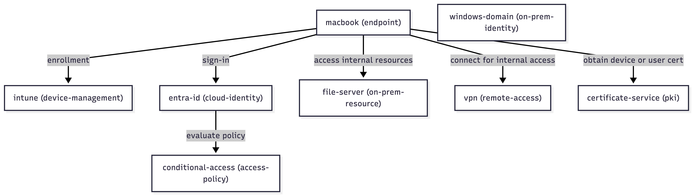
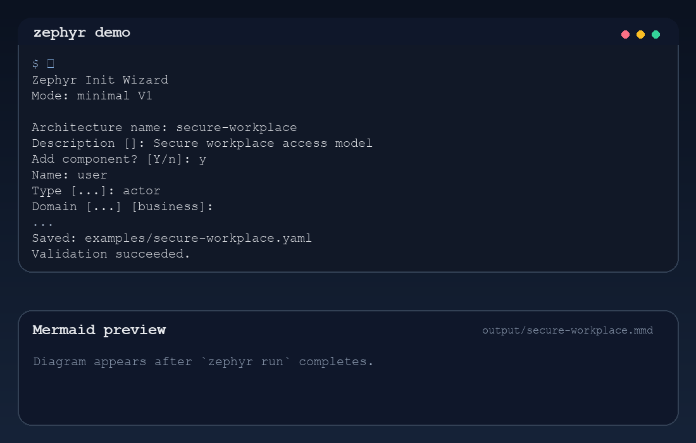

# zephyr-workbench

[](https://www.python.org/)
[](https://github.com/MCamner/zephyr-workbench/actions/workflows/ci.yml)
[](https://github.com/MCamner/zephyr-workbench)

👉 **GitHub Pages:** [https://mcamner.github.io/zephyr-workbench/](https://mcamner.github.io/zephyr-workbench/)

**Model infrastructure. Understand flows. Generate architecture.**

CLI-based architecture workbench for modeling infrastructure, identity, and workplace systems using YAML, validation, summaries, and diagrams.

---

## Case Study

Most architectures look right.
Few are validated.

Zephyr models a real enterprise setup — **macOS + Intune + Entra ID + on-prem AD** — and exposes hidden risks instantly.

- Finds failure points
- Reveals trust gaps
- Outputs summary + diagram in seconds

[View the full case](docs/case-macos-enterprise.md)

### Architecture preview

From model → validated → visualized:



---

## Quick start

```bash
python3.11 -m venv .venv
source .venv/bin/activate
pip install -e ".[dev]"
```

```bash
zephyr init --minimal          # create a model interactively
zephyr run examples/macos-intune-windows-domain.yaml
```

**Fastest path:** `init` → create model, `run` → validate + summary + diagram

---

## Demo



Minimal init, end-to-end run, and diagram preview in one short terminal flow.

---

## What it does

Zephyr Workbench helps you:

- Describe infrastructure systems in a structured YAML format
- Validate models before rendering — errors block, warnings inform
- Generate structured summaries: components, flows, risks, controls, stakeholders
- Produce Mermaid or HTML diagrams
- Diff two models to see what changed
- Search across components, flows, and risks by field value

Built for real-world architecture where **identity, endpoints, and trust boundaries matter**.

---

## Commands

| Command | What it does |
| ------- | ------------ |
| `zephyr run <file>` | Validate + summary + diagram in one step |
| `zephyr validate <file>` | Check for errors and warnings (`--json` for result envelope) |
| `zephyr summary <file>` | Print structured summary (`--json` for machine output) |
| `zephyr diagram <file>` | Generate diagram (`--format mermaid\|html\|png`) |
| `zephyr diff <a> <b>` | Compare two models, exits 1 if changes exist |
| `zephyr add <file>` | Add components, flows, risks, controls, or stakeholders interactively |
| `zephyr search <file> <query>` | Filter by field, e.g. `type=endpoint`, `severity=high`, `missing=mitigation` |
| `zephyr init` | Create a new model (wizard or `--template <name>`) |
| `zephyr templates` | List available starter templates |
| `zephyr import <file>` | Import Mermaid/draw.io or a supported raster diagram |
| `zephyr analyze <file>` | Explain patterns, dependencies and improvement suggestions |
| `zephyr review <file>` | Rule-based review; `--template` selects a focused checklist |
| `zephyr review-templates` | List security, zero-trust, resilience and compliance checklists |
| `zephyr explain <file> <risk-id>` | Explain a risk using its explicit references |
| `zephyr score <file>` | Score model quality across five dimensions |
| `zephyr lifecycle <file>` | Find deprecated-in-use and disconnected planned components |
| `zephyr report <file>` | Generate a Markdown or HTML review report |
| `zephyr impact <before> <after>` | Assess changes; exits 1 for high/critical impact |
| `zephyr govern <policy> <file>` | Apply governance policy; exits 1 for error violations |
| `zephyr snapshot save/list/diff/impact/delete` | Manage named model snapshots |
| `zephyr history <file>` | Show snapshot scores and evolution |
| `zephyr memory add/remove/list/search/compare/refresh` | Index models, inspect freshness and compare typed topology |
| `zephyr reference` | Show all valid field values |
| `zephyr help` | Full usage guide |

### Useful flags

```bash
zephyr run <file> --format html --open      # open diagram in browser immediately
zephyr run <file> --format html --watch     # live-reload on file changes
zephyr validate <file> --json              # stable result envelope
zephyr summary <file> --json               # machine-readable output
zephyr diagram <file> --format png         # PNG export (requires mmdc)
```

---

## Reviews, memory and browser drafts

```bash
zephyr review examples/secure-workplace.yaml --template security --json
zephyr report examples/secure-workplace.yaml --format md
zephyr govern examples/governance-policy.yaml examples/secure-workplace.yaml --json
zephyr memory add examples/identity-flow.yaml
zephyr memory list --json
zephyr memory refresh --json
```

Analysis and reviews are deterministic rules, not an LLM or a compliance certification.
Memory search matches keywords; it does not use embeddings or understand synonyms.
Entries report `current`, `changed`, `missing`, `unreadable`, or `unknown` source status.
Use `memory refresh` to reindex changed/legacy entries. Missing or invalid sources remain
visible and are reported rather than removed silently.
Comparison uses typed directed graph features and two-hop neighborhoods, including
node/edge multiplicity and flow security attributes. It is a bounded similarity metric,
not proof that two graphs are equivalent; scores differ from earlier type-only comparisons.

The browser workbench saves YAML drafts and the active file in local storage, including
invalid work in progress. Reload restores them. Storage failures and changes from another
tab are shown explicitly. Corrupt saved data is preserved until you choose to replace it.
Export YAML for a durable copy; clearing browser storage removes drafts.
Scoring, governance, history and memory workflows are available through the CLI/Python API.

## Image import

```bash
pip install -e ".[image]"
# Install the local Tesseract executable separately and ensure it is on PATH.
zephyr import diagram.png --validate --json
```

Raster recognition is experimental: light background, dark rectangular boxes, and straight
horizontal/vertical arrows through box centers; maximum 2500 pixels per side. Labels are
read by local OCR and component types default to `application`. Lines without a detected
arrow direction are omitted with a warning. Curved connectors, complex layouts and other
shapes require manual modeling or Mermaid/draw.io input. Check every import against the
image. Images of Mermaid/draw.io source text can also be read with OCR.
Imports always validate the generated model before writing; failures return an error
and leave the output untouched. See [tool contracts](docs/tool-contracts.md).


## Example output

```text
zephyr run examples/macos-intune-windows-domain.yaml
```

```text
Validation passed

Architecture: macos-intune-windows-domain
Owner:        platform-team
Version:      v1
Criticality:  mission-critical
Environment:  prod
Components:   8
Flows:        6
Risks:        3
Controls:     3
Stakeholders: 3

Risks:
- [HIGH] R1: Unclear trust boundary between Entra-managed identity and on-prem domain access
  likelihood: high | impact: high
  Mitigation: Implement Entra ID Kerberos to bridge cloud and on-prem identity.

- [MEDIUM] R2: Certificate dependency not documented for secure access
  likelihood: medium | impact: high
  Mitigation: Configure SCEP-based auto-renewal via Intune.

Diagram generated: output/macos-intune-windows-domain.mmd
```

---

## Model structure

Every model is a YAML file. The full schema is at `schemas/architecture.schema.yaml`.

**Required:**

```yaml
name: my-architecture
components:
  - name: api
    type: application
flows:
  - from: api
    to: api
    label: self
```

**Optional top-level fields:**

| Field | Description |
| ----- | ----------- |
| `description` | Free-text description shown in summary |
| `meta` | Owner, version, criticality, environment |
| `risks` | Weaknesses with severity, likelihood, impact, mitigation |
| `controls` | Technical, policy, or process measures with `applies_to` |
| `stakeholders` | People or teams with roles |
| `rules` | Per-model required fields that generate warnings |

**Example with meta:**

```yaml
meta:
  owner: platform-team
  version: v1
  criticality: mission-critical
  environment: [prod]
```

**Example rules block:**

```yaml
rules:
  require:
    component: [criticality, domain]
    risk: [mitigation]
```

---

### Explicit risk scope

Optional references make risk explanations traceable. Flow references use the same
`from`, `to`, and optional `label` as the model's flow (include the label when present).
Unknown references are validation errors. Older risks without references remain valid;
Zephyr does not invent affected components for them.

```yaml
risks:
  - id: R1
    title: Unprotected access
    severity: high
    components: [api]
    flows:
      - from: client
        to: api
        label: request
    controls: [require-mfa]
    mitigation: Require MFA before access
```

The named components, flow and control must exist in the surrounding model.
Diffs include descriptions, tags, trust boundaries, mitigation and risk references.


## Validation

**Errors** block the pipeline:

- Missing required fields (`name`, `components`, `flows`)
- Invalid field values (component type, risk severity, etc.)
- Duplicate component names or risk IDs
- Flow references to non-existent components

**Warnings** flag risky patterns:

- Endpoint-to-endpoint flows
- Single access-gateway (SPOF)
- MFA flow targeting a non-identity component
- Custom per-model rules via `rules.require`

---

## Project structure

```text
zephyr/      CLI and core logic
  loader.py      YAML loading and model construction
  validation.py  Validation rules and warnings
  analyzer.py    Summary generation
  diagram.py     Mermaid and HTML rendering
  diff.py        Model comparison
  search.py      Field filtering
  add.py         Interactive item addition
  init_wizard.py Model creation wizard
  templates.py   Starter templates
  reference.py   Valid field values
examples/    Sample architectures
schemas/     Field reference (architecture.schema.yaml)
tests/       pytest regression tests and browser-core checks
docs/        Case studies and assets
```

---

## Why Zephyr

Architecture is usually:

- Fragmented across slides
- Inconsistent between teams
- Hard to reason about
- Difficult to validate before implementation

Zephyr makes architecture:

> **Executable, testable, and repeatable**

Define once → validate → analyze → visualize → reuse.

---

## Philosophy

- Model first, diagram later
- Structure over slides
- Simplicity over abstraction
- Built for real operations

---

## Roadmap

See [ROADMAP.md](ROADMAP.md) for planned features.

---

## Security

CLI analysis, OCR and model storage run locally. Browser pages and generated HTML diagrams
load JavaScript libraries from external CDNs; they require network access for those assets.

Do not commit secrets or credentials into schema files. Use environment variables or ignored local files for sensitive values.

---

## License

MIT
